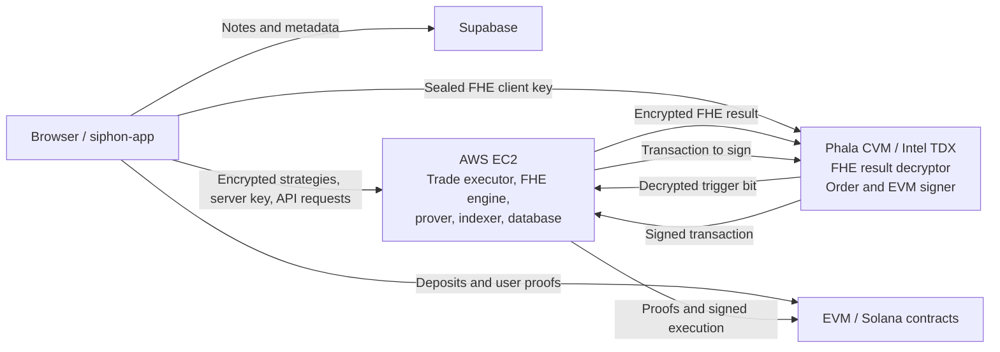

# Siphon Full Product Audit Report

**Audit date:** 15 July 2026  
**Audit type:** Source code, configuration, architecture, local build/test, privacy, scalability, performance, and cost review  
**Repositories, audited in order:**

1. `siphon-app` — commit `2cbb2f2`
2. `siphon-fhe` — commit `86640d5`
3. `siphon-zk` — commit `7c71214`
4. `siphon-contracts` — commit `dd7d0d7`

## Executive summary

Siphon is not ready to custody production funds in its current state.

The Phala TDX attestation and sealed-key design provides a strong foundation for keeping FHE decryption and signing keys outside ordinary EC2 memory. That protection is substantially weakened by other trust boundaries:

- Private ZK witnesses, including note secrets and Merkle paths, are sent to the EC2 proving relay. Compromising EC2 can therefore become a direct withdrawal-theft event.
- Wallet authorization is disabled by default in the trade executor, and its enabled form is permanently replayable.
- A frontend-public token is reused to protect executor, proving, and nullifier-management endpoints.
- The Phala EVM signing service accepts broadly arbitrary transactions from EC2. The TEE prevents key extraction but does not prevent signing-key misuse.
- Production Groth16 trusted-setup provenance is not established through an auditable multi-party ceremony.
- The configured EVM routers do not implement the ABI selector used by the vault contracts, bricking production swaps.
- Native EVM strategy execution passes WETH where Entrypoint expects the native sentinel, causing `VaultNotFound`.
- The Solana relayer can publish arbitrary Merkle roots, and proofs are not bound to SOL versus an SPL mint. A compromised relayer can drain pooled assets.
- Current EVM and Solana test gates are not reliable.

### Overall assessment

| Repository | Security | Privacy | Scalability | Speed | Costs |
|---|---|---|---|---|---|
| `siphon-app` | Blocker | Blocker | High risk | High risk | High risk |
| `siphon-fhe` | Blocker | Blocker | Blocker | High risk | High risk |
| `siphon-zk` | Blocker | High risk | High risk | High risk | High risk |
| `siphon-contracts` | Blocker | High risk | High risk | Blocker | High risk |

Severity definitions:

- **Critical/Blocker:** credible fund loss, key misuse, proof forgery, or complete security-boundary failure; must be addressed before production custody.
- **High:** serious authorization, privacy, availability, execution, or scaling failure.
- **Medium:** meaningful risk requiring particular conditions or operational error.
- **Low:** defense-in-depth, correctness, documentation, or efficiency weakness.

## System architecture and trust boundaries

### Effective trust model

- The browser creates FHE key material, encrypts private conditions, and seals the client key to a Phala-attested public key.
- EC2 evaluates encrypted conditions and sends encrypted results to Phala for final boolean decryption.
- The Phala CVM holds order-signing and EVM-signing authority.
- EC2 controls scheduling, transaction construction, proof relaying, execution, databases, and most availability-sensitive logic.
- EC2 learns wallets, assets, amounts, schedules, recipients, strategy structure, and execution history.
- EC2 currently also receives ZK witness secrets. This is the most important violation of the intended privacy and custody boundary.

---

# 1. `siphon-app` audit

## Security audit

### APP-C-01 — Private ZK witnesses are sent to EC2

**Severity:** Critical  
**Evidence:**

- [`src/lib/zkHandler.ts`](siphon-app/src/lib/zkHandler.ts) constructs witnesses containing input secrets, nullifiers, change secrets, values, and Merkle paths.
- [`src/lib/proofRelayer.ts`](siphon-app/src/lib/proofRelayer.ts) forwards note secrets to the relayer.
- [`src/app/api/prove/route.ts`](siphon-app/src/app/api/prove/route.ts) forwards arbitrary proof inputs to the EC2 proving service.
- [`src/lib/generateProof.js`](siphon-app/src/lib/generateProof.js) supports direct remote proving.

An attacker cannot redirect an already-created proof because the recipient is proof-bound. However, anyone holding the witness can generate a new valid proof with a different recipient before the nullifier is spent.

**Remediation:**

- Prove locally in the browser; or
- Move proving into a separately measured Phala CVM and encrypt the witness directly to its attested public key.
- Never expose plaintext note witnesses to a normal EC2 process, log, temporary file, queue, or observability system.

### APP-H-01 — Public frontend token reused as backend authentication

**Severity:** High  
**Evidence:** [`src/app/api/prove/route.ts`](siphon-app/src/app/api/prove/route.ts) falls back from `RELAYER_API_TOKEN` to `NEXT_PUBLIC_API_TOKEN`.

Any `NEXT_PUBLIC_*` value is downloadable by every visitor. It cannot authorize paid proving, executor control, or nullifier state changes.

**Remediation:** use short-lived user sessions and server-only service credentials. Apply capability-specific credentials for proving, executor control, nullifier updates, and administrative operations.

### APP-H-02 — Static wallet signatures derive security-sensitive values

**Severity:** High  
**Evidence:** [`src/lib/noteAuth.ts`](siphon-app/src/lib/noteAuth.ts) signs static origin-independent messages to derive the note tag and encryption key.

A malicious site can request the same signing message. If the user approves, it can derive the same tag or encryption material.

**Remediation:** domain-separate every signature by application origin, chain, wallet, purpose, version, nonce, issued-at, and expiration. Prefer an explicit wallet-encryption or locally generated key protected by a passkey/device key.

### APP-H-03 — Wallet authentication signature persists indefinitely

**Severity:** High  
**Evidence:** [`src/lib/walletAuthHeaders.ts`](siphon-app/src/lib/walletAuthHeaders.ts) stores one timestamp/signature in `localStorage`.

The backend intentionally accepts the stored signature without expiration. Theft of the browser value gives indefinite replay.

**Remediation:** implement SIWE-style challenge/response with server-issued nonces, short-lived sessions, expiration, revocation, and replay tracking.

### APP-H-04 — Public proxy routes lack resource controls

**Severity:** High

Affected areas include proving, JSON-RPC proxying, trade-executor proxying, quote verification, and the builder agent.

Missing or inconsistent controls include:

- Authentication.
- Per-wallet/IP quotas.
- Body-size limits.
- JSON-RPC method allowlists.
- Timeouts and concurrency limits.
- Paid-provider spending limits.

**Remediation:** enforce centralized request policy before proxying. Use separate rate and cost budgets for RPC, proving, AI, and execution traffic.

### APP-H-05 — Supabase security cannot be established from source

**Severity:** High if production RLS is incomplete; otherwise informational.

The app directly uses the anonymous Supabase key and tag-based filters without a user-bound JWT boundary visible in the repository.

**Remediation:** export production schema/RLS migrations into source control and add automated cross-user read, insert, update, and delete denial tests.

### Positive controls

The Phala client-key upload path performs meaningful attestation checks, including:

- Hosted DCAP verification.
- Attestation report-data binding.
- Event-log/measurement replay.
- Measurement pinning.
- Sealed-box encryption to the attested key.

This should be retained and applied consistently to proving and signing services.

## Privacy audit

- EC2 receives complete withdrawal witnesses during remote proving.
- Local note secrets are encrypted, but commitment, amount, asset, chain, status, timestamps, and ownership-related metadata remain linkable.
- Strategy metadata and exact threshold values can appear in browser logs.
- Builder prompts and application state may be sent to a third-party model provider.
- On-chain withdrawals reveal amount and recipient.
- Static wallet-derived tags create stable pseudonyms and cross-session linkability.

The product currently provides threshold confidentiality and note-link hiding, not full transaction privacy.

## Scalability test

Measured build/artifact observations:

- `/dapp` client JavaScript: approximately 2.57 MB.
- `/markets` client JavaScript: approximately 2.28 MB.
- `public/zk`: approximately 389 MB.
- FHE WASM assets: approximately 234 MB.
- FHE server-key upload: roughly 24 MB per client key.
- Multiple pollers operate at approximately 5, 8, and 60-second intervals.
- FHE warm-up begins on wallet connection, even before a strategy is created.

Risks include slow mobile startup, high browser memory usage, bandwidth cost, CDN pressure, redundant RPC calls, and poor performance on low-power devices.

## Speed audit

- Production build succeeded.
- Direct TypeScript checking succeeded.
- The production build skips lint/type enforcement.
- Direct linting failed with 4 errors and 48 warnings.
- Remote proving allows 120–300 second timeouts.
- First-use latency includes WASM loading, wallet signing, FHE key generation, and a large server-key upload.

## Costs audit

Unbounded or poorly controlled cost drivers include:

- Remote proof generation.
- Paid RPC proxy traffic.
- Model-provider requests.
- Repeated delivery of large ZK/FHE assets.
- Server-key uploads.
- Dynamic Vercel functions.
- High-frequency polling.

Recommended cost controls:

- Authenticated per-wallet quotas.
- Per-route cost budgets.
- Versioned immutable CDN artifacts.
- Request/result deduplication.
- RPC batching and caching.
- Proof-job admission control.
- Client capability detection before FHE warm-up.

---

# 2. `siphon-fhe` audit

## Security audit

### FHE-C-01 — Wallet authorization is disabled by default

**Severity:** Critical  
**Evidence:** [`trade-executor/app.py`](siphon-fhe/trade-executor/app.py) allows calls whenever `ENFORCE_WALLET_AUTH` is not exactly `1`. The production compose file does not set that flag.

This exposes strategy creation, listing, aborting, key upload, execution, and result retrieval to IDOR/BOLA attacks based on caller-supplied wallet identifiers.

**Remediation:** make authenticated operation the compiled/default behavior. Fail closed if session verification is unavailable.

### FHE-H-01 — Wallet authorization is indefinitely replayable

**Severity:** High  
**Evidence:** [`trade-executor/wallet_auth.py`](siphon-fhe/trade-executor/wallet_auth.py) explicitly removes timestamp expiry.

**Remediation:** server nonce, domain binding, five-to-fifteen-minute session lifetime, revocation, and nonce consumption.

### FHE-H-02 — Tag authentication is not authentication

**Severity:** High

The expected tag token is derived using the client-supplied tag itself as the HMAC key. Anyone with the tag can compute the token.

**Remediation:** authenticate the wallet/session first and map server-side ownership to notes. Do not use a public identifier as an HMAC secret.

### FHE-C-02 — CVM EVM signer accepts arbitrary transactions

**Severity:** Critical  
**Evidence:** [`order-signer/app.py`](siphon-fhe/order-signer/app.py) exposes `/evm/sign` for a fully formed transaction protected primarily by a shared token.

EC2 compromise or token theft can cause arbitrary signing even if the key is not extractable.

**Remediation:** implement capability validation inside the CVM:

- Chain allowlist.
- Target-contract allowlist.
- Function-selector allowlist.
- Zero/bounded native value.
- Token, vault, router, recipient, amount, fee, and deadline validation.
- Strategy/proof/receipt binding.
- Nonce, gas, and fee bounds.
- Replay protection and auditable policy decisions.

### FHE-H-03 — Decryptor authentication and transport are optional

**Severity:** High  
**Evidence:** [`trade-executor/decryptor_client.py`](siphon-fhe/trade-executor/decryptor_client.py) omits its header when the token is empty. [`docker-compose.prod.yml`](siphon-fhe/docker-compose.prod.yml) contains a plaintext HTTP public-IP fallback.

Potential consequences include client-key overwrite, key-presence enumeration, and unauthorized decryption requests.

**Remediation:** mandatory authenticated TLS or mTLS; no insecure production default; rate/body limits; authenticated key ownership; non-enumerable identifiers.

### FHE-H-04 — Inconsistent signer attestation

**Severity:** High

The Polymarket route can verify DCAP evidence, but the measurement pin is optional. The generic EVM signing path does not perform an equivalent attestation check before use.

**Remediation:** pin and verify the signer for every signing mode. Cache attestation only with a bounded lifetime and revalidate after deployment/measurement changes.

### FHE-H-05 — Proving relay is publicly abusable

**Severity:** High

The proving service enables broad CORS, exposes its port, accepts the shared public token, writes private inputs to temporary files, and lacks a durable queue, concurrency limits, and body limits.

### FHE-H-06 — Request body setting is not enforced

`MAX_CONTENT_LENGTH` is declared in configuration but is not applied as Flask's `app.config['MAX_CONTENT_LENGTH']`.

### FHE-M-01 — Rate limiting is bypassable and not horizontally safe

The in-memory limiter uses a spoofable client identifier, grows without bound, and has no shared state across workers.

### FHE-M-02 — Fee-pool reservation can be exhausted

The next-fee-precommitment route can reserve available entries without strong authentication, allowing repeated reservations to temporarily block strategy arming.

### FHE-H-07 — Deployment and supply-chain weaknesses

- Mutable `latest` image tags.
- Unpinned source checkout in the prover image.
- Remote installation scripts.
- Containers running as root.
- Flask development server used in the proving container.
- Production topology/Caddy configuration inconsistencies.
- Credential-like values in a tracked production environment template and git history.

Rotate/revoke any values ever used. Do not copy secret-bearing production configuration into tracked templates.

## Privacy audit

EC2 stores or processes the following in plaintext:

- Wallet/user identifiers.
- Assets and amounts.
- Recipients.
- Strategy type and condition-tree shape.
- Schedules, leg counts, and execution windows.
- Polymarket metadata, position size, and cost basis.
- ZK witnesses and temporary witness files.
- Execution results and transaction history.

FHE protects private threshold values. It does not hide the wallet, trading pair, strategy graph, amount, recipient, schedule, or execution activity from EC2.

Positive controls:

- Plaintext FHE client-key fallback is compiled out of release decryptor builds.
- Client keys are sealed to the attested CVM key.
- Persistent CVM state is encrypted with KMS-derived material.
- Decrypted results are required to be boolean.
- Signing keys can remain inside the Phala CVM.

## Scalability test

Current architecture limitations:

- SQLite executor database.
- Single Gunicorn worker with a long timeout.
- Single-threaded sequential scheduler.
- O(active strategies × conditions/legs) evaluation cycles.
- FHE server-key decompression/deserialization per request.
- CPU-bound FHE operations run inline.
- No bounded job queue or FHE semaphore.
- No proving concurrency controller.
- Recursive condition trees are insufficiently bounded.
- Per-process rate limits cannot coordinate across workers.
- Proving container is limited to 2 GB memory.

Once a scheduler cycle exceeds its configured interval, trigger latency and backlog grow without bound.

## Speed audit

- Trade executor: 50 tests passed with 62 warnings.
- FHE Rust tests did not complete during this audit and must not be considered passing.
- FHE network timeouts reach 60–120 seconds.
- Proof timeouts reach 120–300 seconds.
- FHE service is capped at two CPUs in production compose despite documentation recommending 8–16 vCPUs.
- Serial scheduling makes worst-case trigger time proportional to all active work ahead of a strategy.

## Costs audit

Main cost drivers:

- Always-on compute-optimized EC2.
- FHE CPU consumption.
- Repeated large server-key parsing.
- Groth16 proving CPU/RAM.
- Public endpoint abuse.
- RPC and price-feed calls.
- Logs/database growth.
- Failed and retried transactions.
- Phala CVM compute, storage, and bandwidth.

Exact monthly cost requires AWS and Phala billing access, region, instance type, disk, utilization, egress, and production traffic. The current source also couples services with different scaling requirements onto one host, preventing cost-efficient independent scaling.

---

# 3. `siphon-zk` audit

## Security audit

### ZK-C-01 — Trusted-setup provenance is not production-grade

**Severity:** Critical  
**Evidence:** [`circuits/package.json`](siphon-zk/circuits/package.json) performs a single `siphon-dev` Phase-2 contribution with literal entropy strings. [`scripts/build.sh`](siphon-zk/scripts/build.sh) labels its setup as unsafe for production.

There is no auditable multi-party Phase-2 transcript, independent contributor record, artifact attestation, or production ceremony evidence.

If any setup participant retained toxic waste, arbitrary proofs can be forged.

**Remediation:** conduct a new ceremony for every circuit, with multiple independent contributors, published contribution hashes/transcripts, reproducible circuit hashes, and explicit destruction/attestation procedures. Redeploy verifiers and migrate funds.

### ZK-H-01 — Canonical build and artifact pipeline is inconsistent

**Severity:** High

- Build scripts target a missing `circuits/main.circom`.
- One script contains a developer-specific absolute PTAU path.
- The tracked root R1CS/zkey has five public inputs.
- The tracked root `verification_key.json` reports nine public inputs and does not match the zkey.
- Tests target an older single-input interface.
- Current source implements W1–W6, M2–M6, swap, and split.

Positive validation: all 13 proving artifacts shipped in `siphon-app` match the public-input counts and IC points in all 13 Solidity verifiers. The current swap source also matches its proving key. The unresolved risk is provenance and reproducibility.

### ZK-M-01 — No chain/vault/asset/action domain separation

**Severity:** Medium

Commitments and nullifiers do not include chain ID, vault/entrypoint, asset, action, or circuit version. A proof can replay in another domain if a matching root exists, while nullifier state remains local to each vault/program.

**Remediation:** derive a circuit domain from chain, contract/program, pool/vault, asset/mint, circuit version, and operation. Include it in commitments, nullifiers, and public signals.

### ZK-H-02 — Dependency vulnerabilities

`npm audit` reported 21 findings:

- 4 high.
- 4 moderate.
- 13 low.

High dependency paths include `jsonpath`, `minimatch`, `underscore`, and `ws`. Most appear in build/test tooling but should still be removed, pinned, or updated in a hardened release pipeline.

## Privacy audit

Public data includes:

- Withdrawal amount and recipient.
- Root, nullifiers, and change commitment.
- Swap input amount, recipient, output token, pool, fee, and minimum output.
- Chosen verifier size, revealing note count and fragmentation.
- Eight split commitments.

Test helpers also write witness material to temporary files without guaranteed deletion.

The circuits provide note/deposit unlinkability, not hidden amounts, recipients, routes, or execution timing.

## Scalability test

Measured current constraint counts:

| Circuit | Constraints |
|---|---:|
| Withdrawal W1 | 19,461 |
| Withdrawal W6 | 110,936 |
| Merge M2 | 37,614 |
| Merge M6 | 110,798 |
| Swap | 19,461 |
| Split | 27,569 |

Proof work scales nearly linearly with note count. Thirteen independent circuit variants multiply ceremony, build, deployment, artifact, cache, monitoring, and incident-response work.

Artifact footprint:

- Circuit build directory: approximately 242 MB.
- App ZK public assets: approximately 389 MB.

## Speed audit

- Current Circom source compiles.
- Canonical build scripts fail because the expected entry file is absent.
- Jest is unavailable in the current circuit workspace.
- Existing tests target stale five-signal artifacts and skip when required files are absent.
- Larger W/M circuits materially increase browser witness generation and proof latency.
- Remote proving improves client latency only by accepting the critical EC2 witness-custody risk.

## Costs audit

Cost drivers include:

- Thirteen Phase-2 ceremonies.
- Thirteen verifier deployments.
- Large CDN/storage artifacts.
- Browser memory and CPU.
- EC2 proving CPU/RAM.
- CI artifact generation and validation.
- On-chain proof verification and Merkle insertion.

Required release manifest fields:

- Circuit source hash.
- Compiler/toolchain hash.
- R1CS hash.
- PTAU identity/hash.
- Zkey hash.
- Verification-key hash.
- Solidity/Rust verifier hash.
- Public-signal schema/version.
- Contributor transcript and attestations.

---

# 4. `siphon-contracts` audit

## Security audit

### CONTRACT-C-01 — Solana relayer can fabricate roots and drain assets

**Severity:** Critical  
**Evidence:** [`solana/programs/siphon-zk-pool/src/instructions/update_root.rs`](siphon-contracts/solana/programs/siphon-zk-pool/src/instructions/update_root.rs) lets the configured relayer publish any nonzero root.

No constraint or proof establishes that the new root extends the sequence of deposited commitments.

A compromised relayer can construct a root containing its own note without a matching deposit, publish that root, produce a valid membership proof, and withdraw pooled assets.

**Remediation:** maintain the incremental tree on-chain or require a validity proof that binds the new root to the previous root and exact new commitments.

### CONTRACT-C-02 — Solana proof does not bind the withdrawn asset

**Severity:** Critical

SOL and every SPL mint share one Merkle tree, verifier, nullifier namespace, and vault authority. The five public signals in [`withdraw_sol.rs`](siphon-contracts/solana/programs/siphon-zk-pool/src/instructions/withdraw_sol.rs) do not contain an asset/mint domain.

A note funded using one asset can authorize withdrawal of another asset with the same raw amount. Combined with arbitrary roots, this is a complete custody blocker.

**Remediation:** use per-mint/native pool, tree, and nullifier PDAs, or cryptographically bind the program, pool PDA, mint/native identifier, action, and version into every commitment, nullifier, and proof.

### CONTRACT-H-01 — Production EVM router ABI mismatch

**Severity:** High  
**Evidence:**

- [`evm/src/states/NativeVault.sol`](siphon-contracts/evm/src/states/NativeVault.sol) and [`AlternativeVault.sol`](siphon-contracts/evm/src/states/AlternativeVault.sol) call the legacy eight-field Uniswap V3 `exactInputSingle` interface.
- [`evm/scripts/deployEntrypoint.ts`](siphon-contracts/evm/scripts/deployEntrypoint.ts) configures Base SwapRouter02, which exposes a different seven-field selector.
- The configured Sepolia custom router also exposes a different method.

All production swaps reach an unsupported selector and revert. State/nullifier changes roll back, but gas is spent and strategies cannot execute.

**Remediation:** use the explicit Router02 interface or an audited chain-specific adapter. Fork-test against the exact deployed router addresses and bytecode.

### CONTRACT-H-02 — Native backend passes the wrong vault key

**Severity:** High  
**Evidence:** [`siphon-fhe/trade-executor/evm_executor.py`](siphon-fhe/trade-executor/evm_executor.py) converts the native sentinel to WETH before calling Entrypoint. [`evm/src/Entrypoint.sol`](siphon-contracts/evm/src/Entrypoint.sol) looks up the vault before its internal WETH conversion.

The deployment initializes native liquidity under the sentinel, not WETH. Native TWAP/grid swaps therefore revert `VaultNotFound`.

**Remediation:** the backend must pass the native sentinel. WETH conversion should remain inside Entrypoint/Vault.

### CONTRACT-C-03 — EC2 witness compromise permits fresh withdrawal proofs

**Severity:** Critical systemic boundary

Entrypoint withdrawals are intentionally permissionless, and Vault authorizes the proof-selected recipient. A copied proof cannot redirect funds, but a party holding the full witness can create a new proof to its own recipient.

Therefore the `siphon-app`/EC2 witness leak translates directly into contract-level fund-theft capability.

### CONTRACT-H-03 — Swap expiry is not proof-bound

**Severity:** High

Entrypoint accepts a relayer-supplied deadline, while [`Vault.sol`](siphon-contracts/evm/src/abstracts/Vault.sol) omits it from public signals. Historic roots remain valid indefinitely.

An unused proof can be executed later using a refreshed deadline, despite off-chain cancellation or expiry.

**Remediation:** bind `validAfter`, `validUntil`, strategy nonce, and domain into the proof. Add an on-chain cancellation mechanism if cancellation is promised.

### CONTRACT-M-01 — Immutable dependencies are insufficiently validated

Verifier, router, WETH, and factory dependencies are immutable, but constructors do not consistently require nonzero deployed code or validate expected interfaces/code hashes.

A wrong verifier can permanently lock a particular withdrawal/merge size. A wrong router can permanently disable swaps.

### CONTRACT-M-02 — Emergency pause cannot contain proof compromise

EVM pause blocks deposits and swaps but leaves withdrawals, merges, and splits active. This protects ordinary user exit but cannot stop a forged-proof drain.

Consider a two-tier incident mechanism: immediate deposit/strategy pause plus a narrowly governed, short-lived proof-operation freeze with a transparent escape/migration path.

The Solana config contains a pause flag but exposes no instruction that can change it.

### CONTRACT-M-03 — SPL fee recipient ownership is not enforced

The Solana SPL withdrawal checks the fee token mint but does not require that the token account owner equals the configured fee-recipient public key. The relayer can select another same-mint fee account.

### CONTRACT-M-04 — Arbitrary token behavior can break vault solvency

Owner-created vaults are not limited to standard non-rebasing/non-fee-on-transfer tokens. Negative rebases can undercollateralize notes; outbound transfer fees can consume the full note while paying the recipient less.

### CONTRACT-L-01 — Proof-bound pool address is not used

Vault compares the proof pool to calldata, but actual router execution derives the pool from token pair and fee. The proof's exact-pool authorization claim is therefore not enforced.

### CONTRACT-L-02 — Permissionless proof front-running can grief execution

A mempool observer can copy a proof submission, consume the nullifier first, and cause the executor transaction to revert. Outputs cannot be redirected, but executor gas and off-chain status can be disrupted.

Use private transaction submission where available and reconcile state by nullifier/receipt, not solely by the executor's transaction sender/hash.

### Positive controls

- No direct Vault access-control bypass was identified.
- Fund-moving Vault methods use reentrancy protection.
- Factory deployment is gated and authorization is one-shot.
- State changes roll back on failed transfers/router calls.
- Fee-on-transfer deposits credit the balance actually received.

## Privacy audit

EVM events expose:

- Depositor.
- Exact deposit amount.
- Commitment and precommitment.
- Withdrawal amount and recipient.
- Nullifiers and change commitment.
- Swap amount, recipient, pool, output token, fee, and minimum output.

Solana transactions/events expose depositor linkage, amount, mint/native asset, commitment, recipient, fee, and change metadata. Encrypted note output does not hide the transaction envelope.

## Scalability and speed audit

### EVM test status

- 6 passing.
- 18 pending/skipped.
- 23 failing.

The shared fixture in [`evm/test/helpers/fixtures.ts`](siphon-contracts/evm/test/helpers/fixtures.ts) omits the split-verifier constructor argument. Consequently, most access-control, pause, swap, size, and integration tests do not execute.

### Measured EVM gas

Measurements used Hardhat and permissive mock verifiers:

| Operation | Gas |
|---|---:|
| Initialize one native vault | 6,036,877 |
| First deposit | 2,519,687 |
| Subsequent deposit | 2,463,377 |
| Merge two notes | 2,435,528 |
| Split into eight notes | 17,306,946 |

Each insertion performs 32 Poseidon hashes in [`MerkleTree.sol`](siphon-contracts/evm/src/states/MerkleTree.sol). Split performs eight complete insertions and consumes approximately 57.7% of the local 30-million-gas block.

Permanent `knownRoots` storage grows O(leaves). Nullifier storage grows O(spends). This is not zero-cost state.

### Contract sizes and deployment

- Entrypoint runtime: approximately 5.550 KiB.
- NativeVault: approximately 9.419 KiB.
- AlternativeVault: approximately 8.998 KiB.
- Factories: approximately 13.0–13.6 KiB.
- PoseidonT3: approximately 29.998 KiB, above the ordinary EIP-170 runtime limit if deployed directly.

Hardhat only warns because contract sizing is non-strict and local testing allows unlimited contract size. The deployment script checks only that a Poseidon address contains some code, not that it contains the expected bytecode.

The deployment requires 16 contract deployments, two factory authorizations, and one initialization transaction: 19 sequential confirmations.

### Solana test/build status

- The TypeScript test file contains no active tests.
- Local compilation could not be completed because the pinned Rust toolchain download failed during installation.
- This is an unverified build status, not a confirmed source compilation failure.

## Costs audit

Illustrative execution-only EVM cost, excluding L1-data fees and real Groth16 verifier overhead:

| Operation | At 0.01 gwei | At 0.1 gwei |
|---|---:|---:|
| Vault initialization | 0.00006037 ETH | 0.00060369 ETH |
| Deposit | 0.00002463 ETH | 0.00024634 ETH |
| Merge two | 0.00002436 ETH | 0.00024355 ETH |
| Split eight | 0.00017307 ETH | 0.00173069 ETH |

Solana additionally creates rent-bearing commitment PDAs per deposit and nullifier PDAs per withdrawal.

Dependency audit results:

- EVM JavaScript: 1 high and 3 moderate vulnerabilities.
- Solana JavaScript: 1 high and 7 moderate vulnerabilities.
- `snarkjs` is specified as mutable `latest`.
- Dual npm/Bun lockfiles introduce release-tool ambiguity.

---

# Cross-repository risk register

| ID | Severity | Risk | Primary owner |
|---|---|---|---|
| SYS-C-01 | Critical | EC2 receives private ZK witness and can create fresh withdrawal proofs | App/ZK/backend |
| SYS-C-02 | Critical | CVM EVM signer signs overly broad arbitrary transactions | CVM/backend |
| SYS-C-03 | Critical | Trusted-setup provenance does not support production custody | ZK/contracts |
| SYS-C-04 | Critical | Solana relayer can fabricate roots and drain pools | Solana contracts |
| SYS-C-05 | Critical | Solana proofs do not bind withdrawn asset/mint | Solana contracts/ZK |
| SYS-H-01 | High | Wallet authorization disabled by default and indefinitely replayable | Backend/app |
| SYS-H-02 | High | Frontend-public token protects privileged/paid endpoints | App/backend |
| SYS-H-03 | High | EVM router ABI mismatch bricks swaps | EVM contracts/deployment |
| SYS-H-04 | High | Backend native sentinel conversion bricks native swaps | Backend/EVM contracts |
| SYS-H-05 | High | Proof deadline omitted, allowing stale execution | ZK/EVM contracts |
| SYS-H-06 | High | Single-worker SQLite scheduler cannot scale safely | Backend |
| SYS-H-07 | High | Current CI/test gates do not establish release correctness | All repositories |

# Remediation plan

## P0 — before accepting or retaining production funds

1. Disable remote plaintext witness proving on ordinary EC2.
2. Rotate all potentially exposed API tokens, RPC credentials, database keys, and signer/decryptor tokens.
3. Replace the public bearer token with short-lived authenticated sessions and service-to-service credentials.
4. Make wallet authentication mandatory and replay-resistant.
5. Add rate, body, concurrency, and cost controls to every externally reachable route.
6. Implement strict capability enforcement inside the Phala order/EVM signer.
7. Require pinned attestation for every decryptor and signer path.
8. Conduct new multi-party Phase-2 ceremonies and redeploy/migrate verifier-dependent contracts.
9. Keep the Solana program unfunded until root extension and asset-domain bugs are fixed.
10. Correct Router02 ABI integration and native-sentinel handling.
11. Restore EVM/Solana CI and make failures/skips release-blocking.

## P1 — before public scale-up

1. Move executor state from SQLite to PostgreSQL.
2. Introduce durable queues for FHE evaluation, proving, and chain execution.
3. Run multiple bounded workers and distributed rate limits.
4. Cache validated/deserialized FHE server keys.
5. Bound condition-tree depth, strategy count, leg count, body size, and proof concurrency.
6. Make artifacts immutable, versioned, hash-verified, and CDN-cacheable.
7. Reduce polling through event subscriptions, backoff, aggregation, and visibility-aware refresh.
8. Redesign or explicitly price the eight-insertion split operation.
9. Add per-route and per-strategy cost telemetry.
10. Add bytecode-hash and configuration validation to deployment automation.

## P2 — defense in depth and product accuracy

1. Define privacy guarantees precisely in product documentation.
2. Add chain/vault/asset/action/version domains to commitments and nullifiers.
3. Add private transaction submission or robust nullifier-based reconciliation.
4. Version and test Supabase RLS policies.
5. Remove stale docs, scripts, artifacts, mutable dependencies, and unused packages.
6. Introduce incident runbooks covering EC2 compromise, signer compromise, proving-key compromise, credential leakage, and contract migration.

# Required verification after remediation

- Independent security review of modified trust boundaries.
- Reproducible clean builds from pinned toolchains.
- Complete unit, integration, fuzz, and invariant suites.
- Fork tests against exact production routers/tokens.
- Load tests covering concurrent strategies, FHE jobs, proofs, and chain congestion.
- End-to-end Phala attestation tests for decrypting, proving, and signing.
- Cross-user Supabase authorization tests.
- Cross-chain/vault/mint replay tests.
- Ceremony transcript and artifact-hash verification.
- Production configuration audit without exposing secret values.
- Billing review using AWS, Phala, Vercel, RPC, Supabase, model-provider, and chain-cost data.

# Audit limitations

This report is a source/configuration/local-test audit, not a formal verification, production penetration test, or legal/compliance certification.

The audit did not access:

- Live AWS resources, IAM, security groups, billing, or CloudWatch.
- Live Phala CVM configuration, secrets, runtime logs, or current attestation state.
- Production Supabase schema/RLS/data.
- Vercel configuration or billing.
- Production databases.
- Deployed contract state or admin ownership.
- Current RPC/provider dashboards.
- Real user traffic or production load.

All repositories were source-clean at completion, and no product source files were modified during the audit.
