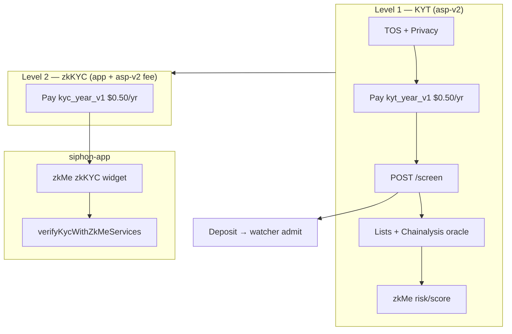
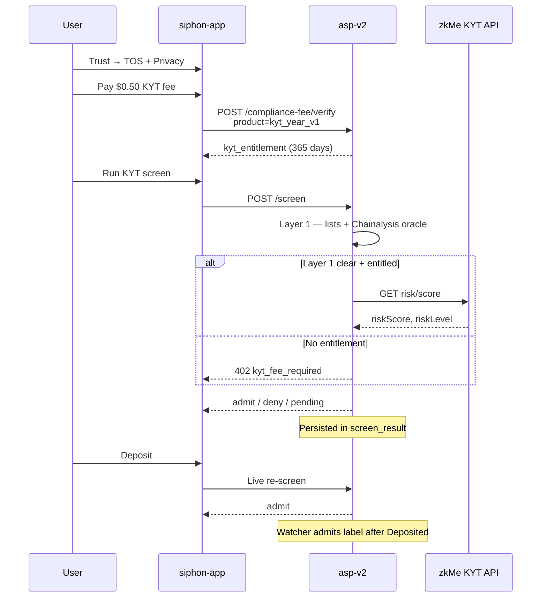
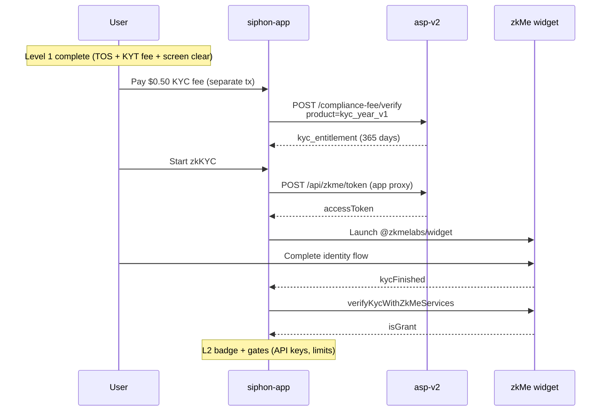
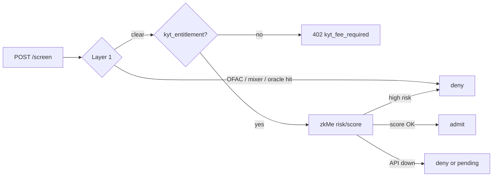

# Compliance flows — KYT & zkKYC

siphon-aspv2 is the **fee ledger and KYT screening authority**. zkKYC identity runs in
**siphon-app** via the zkMe widget, but **KYC fee entitlements** (`kyc_year_v1`) are stored
here alongside KYT (`kyt_year_v1`).

**KYT and KYC are separate products** — $0.50 / wallet / year each, separate on-chain
payments to `ASP_COMPLIANCE_VAULT`. One fee does not cover the other.

| Product | ASP table | Purpose | Required for deposits? |
|---------|-----------|---------|------------------------|
| `kyt_year_v1` | `kyt_entitlement` | Transaction-risk screening (zkMe `risk/score`) | Yes (Level 1) |
| `kyc_year_v1` | `kyc_entitlement` | zkKYC widget access (identity) | No (Level 2) |

---

## Overview



---

## Level 1 — KYT (required to deposit)

Transaction-risk screening at screen time. asp-v2 calls zkMe server-side when
`kyt_entitlement` is active.



### Step-by-step

1. User connects wallet → Trust tab → accepts TOS + Privacy.
2. Pays **KYT fee** (`product=kyt_year_v1`) to `ASP_COMPLIANCE_VAULT`.
3. App calls `POST /compliance-fee/verify` → asp-v2 writes `kyt_entitlement` (365 days).
4. App proxies `POST /screen`:
   - **Layer 1:** OFAC/mixer lists + Chainalysis `isSanctioned` (zkMe never called on hit).
   - **Layer 2:** zkMe `risk/score` only when entitled.
5. Result `admit` | `deny` | `402 kyt_fee_required` → `screen_result` + `/decisions`.
6. On deposit: live re-screen; watcher admits from pending outbox after on-chain `Deposited`.

### API

```bash
# Check KYT entitlement (default product)
curl -s -H "Authorization: Bearer $ASP_SCREEN_TOKEN" \
  "https://api.siphon.money/aspv2/compliance-fee/check?wallet=0xWALLET&product=kyt_year_v1"

# Screen (402 if KYT fee unpaid and zkMe configured)
curl -s -X POST https://api.siphon.money/aspv2/screen \
  -H "Authorization: Bearer $ASP_SCREEN_TOKEN" \
  -H "Content-Type: application/json" \
  -d '{"chainId":8453,"depositor":"0xWALLET"}'
```

---

## Level 2 — zkKYC (optional)

Identity credential via zkMe browser widget. asp-v2 holds the **KYC fee ledger** only —
no identity PII. Widget + verification live in siphon-app.



### Step-by-step

1. User completes Level 1.
2. Pays **KYC fee** (`product=kyc_year_v1`) — **separate** $0.50 tx → `kyc_entitlement`.
3. App mints widget token (`ZKME_API_KEY` stays server-side).
4. zkMe widget opens (`lv: zkKYC`).
5. User completes zk.me identity flow; app handles `kycFinished`.
6. App verifies via `verifyKycWithZkMeServices`; Level 2 gates unlock.

**Total if user wants both:** $1.00/year (two separate payments).

### API (asp-v2 side)

```bash
# Check KYC entitlement
curl -s -H "Authorization: Bearer $ASP_SCREEN_TOKEN" \
  "https://api.siphon.money/aspv2/compliance-fee/check?wallet=0xWALLET&product=kyc_year_v1"

# Verify KYC fee payment
curl -s -X POST https://api.siphon.money/aspv2/compliance-fee/verify \
  -H "Authorization: Bearer $ASP_SCREEN_TOKEN" \
  -H "Content-Type: application/json" \
  -d '{"wallet":"0xWALLET","txHash":"0x…","chainId":8453,"product":"kyc_year_v1"}'
```

Widget token mint is proxied by siphon-app (`POST /api/zkme/token`), not exposed on asp-v2
public routes from the browser with the API key.

---

## Screening pipeline (asp-v2 internals)



Implementation: `screen.py` → `zkme.py`. Audit: `screen_result` table, `GET /decisions`.

---

## Configuration

| Variable | Purpose |
|----------|---------|
| `ZKME_MCH_NO`, `ZKME_API_KEY` | Server KYT API (+ app widget token mint) |
| `ASP_COMPLIANCE_VAULT` | Fee recipient (both products) |
| `ASP_COMPLIANCE_FEE_WEI` / `ASP_COMPLIANCE_FEE_USDC` | ~$0.50 per product |
| `ASP_KYT_ENTITLEMENT_DAYS` | KYT window (default 365) |
| `ASP_KYC_ENTITLEMENT_DAYS` | KYC window (default 365) |

`/ready` lists `zkme_unconfigured` until `ZKME_*` keys are set. KYC fee tables
(`kyc_entitlement`, `kyc_fee_payment`) are created on `init_db` / first deploy after pull.

Deploy: [DEPLOY.md](./DEPLOY.md) · zkMe rollout: monorepo `audits/ASPV2_ZKME_DEPLOY.md`
