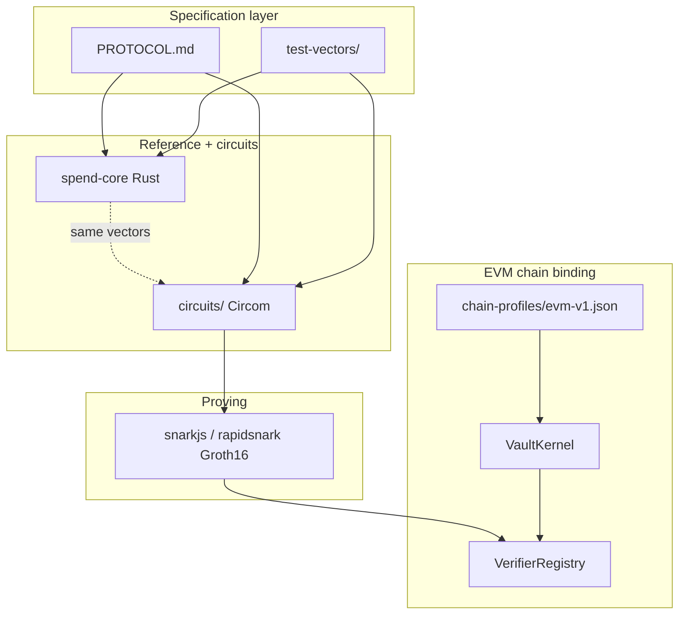

# Siphon Proving Architecture (greenfield)

Status: **Circom Groth16 product stack** + Rust `spend-core` reference.  
**Normative spec:** [`PROTOCOL.md`](../PROTOCOL.md) v3.4.2 (authoritative for spend rules, public layout, on-chain binding).  
This document covers stack, milestones, and build guardrails — when in doubt, **`PROTOCOL.md` wins**.

**Security review:** OMEGA pass 1–5 — guardrails in §12 mirror [`PROTOCOL.md` §15](../PROTOCOL.md#15-omega-guardrails-summary). Closure tracker: [`docs/OMEGA-CLOSURE.md`](OMEGA-CLOSURE.md).

**Compliance model (v3.2):** **ASP inclusion** + **SMT non-inclusion**. **Proving:** Circom → Groth16 (BN254). Chain binding: [`chain-profiles/`](../chain-profiles/).

**Explicit non-goal:** zkVM STARK guests (SP1 / RISC Zero) for product spends — measured slower / too heavy for client or cheap VMs. Keep Railgun-class Circom Groth16.

---

## 1. Design principles


| Principle                     | Implication                                                                          |
| ----------------------------- | ------------------------------------------------------------------------------------ |
| **One semantic core**         | Spend rules in Rust (`spend-core`) **and** Circom MUST match shared JSON vectors.   |
| **Spec before code**          | Single normative `PROTOCOL.md`; JSON test vectors are the contract.                  |
| **Product prove = Groth16**   | Circom circuits → snarkjs / rapidsnark; on-chain BN254 verifier.                     |
| **Fixed on-chain surface**    | Verifier(s) pinned per `programVersion`; 25-limb public semantics.                   |
| **Prove on device or small prover** | Browser / laptop / rapidsnark — not GPU clusters for every arm.               |
| **Compliance in M0**          | ASP inclusion + SMT non-inclusion for **every spent input**                          |
| **Prover privacy by default** | Local prove is production default; hosted prove is opt-in with explicit consent.     |


Legacy v2 Hard ASP (32-slot ASP ring, greedy boundary) is **not** the compliance model — Poseidon + depth-32 Merkle constants that match deployed `CommitmentLib` stay.

---

## 2. Target stack



### Product path

- **Arm / withdraw / merge / swap:** client (or prove API) builds Circom Groth16 proof.
- **On-chain:** verify Groth16 + bind `publicInputs[25]` in `VaultKernel`.
- **`siphon-prove` / spend-guest native:** validate witness + emit limbs for CI — **not** a STARK proof.

### What disappears (vs v2)

- v2 **32-slot `aspRoots` ring** + recency K (replaced by single `admittedRoot`)
- Revoke-via-ASP-tree-eviction (replaced by revocation SMT)
- Required server-side note sync for spend
- zkVM / SP1 product path

### What stays

- Note commitment formula (Poseidon, matches `CommitmentLib`)
- State Merkle tree (depth 32)
- **Association set admission** (ASP) — KYT gate, ZK inclusion per input
- Nullifier bitmap
- VaultKernel / ComplianceHub flow (deposit, withdraw, merge, swap, ragequit)
- Circom Groth16 + browser / rapidsnark prove (Railgun-class)

---

## 3. Universal spend program

Single guest dispatches on **action** (isolated modules in `spend-core` — no shared fall-through):


| Action     | Description                           | Compliance (per active input)     |
| ---------- | ------------------------------------- | --------------------------------- |
| `WITHDRAW` | 1–6 inputs → payout + optional change | ASP inclusion + SMT non-inclusion |
| `MERGE`    | 2–6 inputs → one output note          | ASP inclusion + SMT non-inclusion |
| `SWAP`     | 1 input → change + Uniswap bind       | ASP inclusion + SMT non-inclusion |
| `SPLIT`    | 1 input → up to 8 output commitments  | ASP inclusion + SMT non-inclusion |
| `RAGEQUIT` | 1 input → attributed exit             | ASP inclusion + SMT non-inclusion |


### Private boundary index `k`

- Prover chooses private `k ∈ [0, N)`; VM enforces `outLabel = inLabel[k]`.
- **Merge:** `inValue[k] ≥ inValue[i]` for all active `i`.
- **Withdraw:** single commingling rule (PROTOCOL §6.1): change only on note `k`; other inputs fully consumed.

**Zero-change:** `changeValue = 0` ⇒ `outCommitment = 0`.

### KYT admission gate

1. Deposit → label minted, note in state tree, status `Pending`.
2. KYT pass → postman inserts label into **association tree** → `admittedRoot`.
3. KYT fail → label never in association tree → **cannot produce valid spend proof**.
4. Operational delay (e.g. ~1 min) is fine; gate is cryptographic.

Off-chain association-set mirrors = **forensics only**; spend requires ZK ASP inclusion + current `admittedRoot`.

---

## 4. Dual compliance — ASP admission + SMT revocation (M0 blocker)

| Concern | Mechanism | Public in proof |
| --- | --- | --- |
| **Admission (KYT)** | ASP Merkle **inclusion** — `inLabel[i] ∈ admittedRoot` | `admittedRoot` (index 3) |
| **Revocation** | SMT **non-inclusion** — `smtKey(inLabel[i]) ∉ revokedRoot` | `revokedRoot` (index 4) |

**Retired from v2:** 32-root ASP ring; revoke by ASP eviction alone.

### Guest rules (normative)

For each active input index `i < inputCount` (**all actions, including RAGEQUIT**):

1. `VerifyInclusion(admittedRoot, inLabel[i], admittedPath[i])` — §2.6
2. `VerifyNonInclusion(revokedRoot, smtKey(inLabel[i]), revokedSmtPath[i])` — §2.5 (hashed keys, path bit bind)
3. `inLabel[i] ≠ 0`, `inValue[i] > 0`; distinct labels and nullifiers across active inputs

`RAGEQUIT` pays the recorded depositor; **MUST NOT** Merkle-insert on finalize (§8.4.3).

### On-chain rules (normative)

```solidity
uint256 public admittedRoot;  // single current — no ring
uint256 public revokedRoot;

function admittedRootIsCurrent(uint256 root) external view returns (bool) {
    return root != 0 && root == admittedRoot;
}
function revokedRootIsCurrent(uint256 root) external view returns (bool) {
    return root != 0 && root == revokedRoot;
}
```

**Forbidden:** accepting historical `admittedRoot` / `revokedRoot` values or v2 `aspRoots` ring.

**Postman (atomic revoke):** `ComplianceHub.updateRevokedRoot` in one tx (root-only event; **no** on-chain label map / `markLabelsRevoked`).

**Postman (KYT admit):** insert label into association tree; update `admittedRoot`.

### SMT construction

**`PROTOCOL.md` §2.5** — `smtKey`, `EMPTY_LEAF`, fixtures in `test-vectors/smt/`.

### ASP association tree

**`PROTOCOL.md` §2.6** — label leaves, depth 32, fixtures in `test-vectors/asp/`.

---

## 5. Fixed public inputs (single layout)

One Groth16 verifier per `programVersion`. **Fixed width** — no N-specific verifiers.

### `PUBLIC_WIDTH = 25` (normative)

Core fields (all actions):

| Index | Field | Notes |
| --- | --- | --- |
| 0 | `action` | 0=Withdraw, 1=Merge, 2=Swap, 3=Split, 4=Ragequit |
| 1 | `inputCount` | Action-specific bounds |
| 2 | `stateRoot` | Must exist in vault tree at submit |
| 3 | `admittedRoot` | Must equal ComplianceHub current (ASP, §2.6) |
| 4 | `revokedRoot` | Must equal ComplianceHub current (SMT, §2.5) |
| 5 | `primaryValue` | withdrawn / amountIn (swap) / ragequit amount; **MERGE = 0** |
| 6 | `secondaryValue` | changeValue; 0 for merge/ragequit/split |
| 7 | `outCommitment` | change / merged / ragequit opened note; **0** for zero-change withdraw/swap and **always 0 for split** |
| 8 | `outLabel` | **MUST be 0** (3.4) — inheritance is a private guest constraint |
| 9–14 | `nullifierHash[0..5]` | Indices ≥ inputCount **must be 0** |
| 15 | `recipient` | Withdraw/swap `uint160`; 0 otherwise |
| 16 | `programVersion` | Must match vault pin + registry |

**Action-muxed payload** (indices 17–24 — unused slots **must be 0**):

| Action | 17 | 18 | 19 | 20 | 21 | 22–24 |
| --- | --- | --- | --- | --- | --- | --- |
| **Swap** | `pool` | `dstToken` | `fee` | `minAmountOut` | `outputPrecommitment` | `destCommitment` (22); 23–24 = 0 |
| **Split** | `splitRoot` | 0 | 0 | 0 | 0 | 0 |
| **Ragequit** | `depositor` | 0 | 0 | 0 | 0 | 0 |
| **Withdraw/Merge** | 0 | 0 | 0 | 0 | 0 | 0 |

**Split binding:** `PROTOCOL.md` §4.4 + §8.4.2 — per-index calldata equality; skip zero Merkle inserts.

**Ragequit binding:** guest `public[17] == witness.depositor`; Vault verifies storage; **no** Merkle insert (§8.4.3).

**Swap binding:** mux 17–21 in guest; destination deposit `commitment(amountOut, L_dst, outputPrecommitment)` on-chain (§6.3 step 7).

**Witness ↔ public:** full rules in `PROTOCOL.md` §4.5 (root binding, derived limbs, action bounds).

### Public encoding (Circom ↔ chain ↔ Vault binding)

Single canonical path — no ambiguity:

1. `spend-core` + `chainProfile` → `PublicOutputs::to_bn254_limbs()` (fixed order).
2. Circom Groth16 public signals bind these limbs (circuit family MUST map into the 25-limb layout).
3. **Verification artifact** verifies Groth16 on EVM (future Solana: TBD).
4. Chain adapter rebuilds `uint256[PUBLIC_WIDTH]` and requires equality with verified public inputs.
5. Adapter uses **only** verified `publicInputs` + profile calldata for state changes.

`PROGRAM_VERSION` pins `(guestLogicId, chainProfileId, verifyArtifactId)` — see `manifest/universal-spend-v1.json`. Do not put `chainId` in public inputs.

CI: `test-vectors/public-encoding.json` + tests in `siphon-tests/zkv2/` + Foundry `PublicInputsMatchGuestCommit`.

---

## 6. On-chain verifier model

### 6.1 Proof-first Vault API

**Normative:** `PROTOCOL.md` §8 — action-dispatched `_finalizeSpend`, pre-checks, nullifier burn, per-action insert/payout.

**Forbidden:** parallel `_withdrawnValue` / `_changeValue` calldata (OMEGA-ZK-03); universal Merkle insert when `publicInputs[6] != 0` without action dispatch (ragequit class bug, O-9/O-10).

Summary dispatch (detail + Solidity in PROTOCOL §8.4):


| Action   | Payout                           | Merkle insert                                   |
| -------- | -------------------------------- | ----------------------------------------------- |
| WITHDRAW | `primaryValue` → `recipient[15]` | change note if `[7]≠0` |
| MERGE    | —                                | merged note (`public[7]` only; amount not a public limb) |
| SWAP     | via ActionRouter                 | change note if `[7]≠0`; destination bind §6.3.7 |
| SPLIT    | —                                | each non-zero slice; `[7]=0`                    |
| RAGEQUIT | `primaryValue` → `depositor[17]` | **none** — verify storage, set status |


```solidity
// Sketch — full normative version: PROTOCOL.md §8.4
function spend(
    uint256[PUBLIC_WIDTH] calldata publicInputs,
    uint256[8] calldata proof,
    SplitCalldata calldata split
) external onlyVaultKernel nonReentrant { // sketch name; gate is VaultKernel-only
    require(registry.verifySpend(publicInputs, proof), "proof");
    // §8.2 pre-checks + nullifier burn
    _finalizeSpend(publicInputs, split); // action-dispatched — NOT universal insert
}
```

All payout amounts, labels, and roots read from `publicInputs` only.

### 6.2 VerifierRegistry

```solidity
interface ISiphonVerifier {
    function verifySpend(
        uint256[PUBLIC_WIDTH] calldata publicInputs,
        uint256[8] calldata proof
    ) external view returns (bool);
}

contract VerifierRegistry {
    address public immutable governance; // timelock

    mapping(uint256 version => address) public verifiers;
    mapping(uint256 version => bytes32) public programHashes;

    event VerifierRegistered(uint256 indexed version, address verifier, bytes32 elfHash);

    function registerVerifier(
        uint256 version,
        address verifier,
        bytes32 elfHash
    ) external {
        require(msg.sender == governance, "!");
        require(verifiers[version] == address(0), "exists"); // register-only, no in-place swap
        verifiers[version] = verifier;
        programHashes[version] = elfHash;
        emit VerifierRegistered(version, verifier, elfHash);
    }
}
```

**Per-vault pin:** each Vault deployment immutably allows **one** `programVersion` (no runtime registry hopping).

**Manifest:** deploy script checks verifier / circuit pins against `manifest/universal-spend-v1.json`.

**Groth16 pinning:** pin verifier bytecode hash + zkey hash in the manifest. CI fails if exported Solidity verifier changes without manifest bump.

---

## 7. Proving paths and threat model


| Tier   | Path                                          | Default?                          | Witness exposure               |
| ------ | --------------------------------------------- | --------------------------------- | ------------------------------ |
| **T0** | Local Circom Groth16 (snarkjs / CLI)          | **Yes — production privacy mode** | User machine only              |
| **T1** | Self-hosted rapidsnark / prove API            | Staging / power users             | Ops team; encrypted in transit |
| **T2** | — (zkVM remote)                              | **Rejected for product**          | —                              |


**App requirements (OMEGA: hosted prover)**

1. Default to T0; T1 requires explicit consent naming disclosed fields (nullifiers, secrets, labels, amounts).
2. Client **must** locally recompute public outputs and compare to proof public inputs before tx submit.
3. Never treat “self-hosted” as “trusted” for privacy marketing.

Browser flow:

1. Build witness locally (TS SDK).
2. Prove via snarkjs (or T1 rapidsnark).
3. Verify public inputs locally.
4. Submit proof + publics via relayer.

---

## 8. Circom Groth16 (product)

**Benchmarks:** [`docs/benchmarks/groth16-bench.md`](benchmarks/groth16-bench.md) — withdraw1 ~2–3s, withdraw3 ~6s on reference host.

`spend-core` stays the executable reference for ASP+SMT + action rules; Circom MUST stay vector-equal. No SP1 / RISC Zero path.

---

## 9. Repository layout

```
siphon-zkv2/
  PROTOCOL.md                 # normative spec
  chain-profiles/             # evm-v1.json
  manifest/                   # programVersion + Groth16 pins
  docs/ARCHITECTURE-GREENFIELD.md
  spend-core/                 # Rust reference validator
  spend-guest/                # native limb commit for CI (siphon-prove)
  prover/cli/                 # siphon-prove
  circuits/                   # Circom product circuits (per-action mains)
  test-vectors/               # JSON fixtures

siphon-tests/zkv2/            # zkv2 tests
```

---

## 10. Phased delivery (reordered after OMEGA)


| Milestone | Deliverable                                                                       | Gate (must pass before next)                               |
| --------- | --------------------------------------------------------------------------------- | ---------------------------------------------------------- |
| **M0** | `PROTOCOL.md` v3.3.0 ✅ | ASP + SMT private spend; ragequit escape; chain profiles |
| **M0** | `spend-core` Poseidon + Merkle + **ASP inclusion + SMT non-inclusion** | Not-admitted and revoked-label vectors **must fail** |
| **M1** | `spend-core`: withdraw + merge + ragequit + private `k` + zero-change mux | Unit tests per action module |
| **M2** | Circom Groth16 benches vs product UX | withdraw1/withdraw3 prove times documented |
| **M3** | `VerifierRegistry` + `PublicInputs` + Foundry guest-commit bind ✅ | Calldata ↔ commit binding test passes |
| **M4** | Vault `verifySpend` + ComplianceHub `admittedRoot` + `revokedRoot` ✅ | **No M4 without M0 ASP+SMT** |
| **M5** | swap + split validators + Foundry finalize ✅ | `outputPrecommitment` / splitRoot vector tests |
| **M5d** | deposit bind + on-chain `VaultKernel.deposit` ✅ | `deposit-ok` + journey ragequit |
| **M6** | App SDK: Circom Groth16 arm/withdraw (device-local notes) | Consent UX for T1 prove — see `docs/M6-PROVER-CONSENT.md` |
| **M7** | Align Circom publics to v3.4.2 + MPC ceremony for production zkeys | Flag day; `npm run pin:hashes` + `ceremonyStatus=reviewed` |

**Removed from plan:** “M6 Revocation SMT” as late add-on — ASP + SMT are **M0**.

---

## 11. Known privacy limitations (accepted, documented)

- **Public `outLabel`** on every note-producing spend remains a join key (legacy OMEGA-P1). Circom Groth16 does not fix this by itself — layout rules in PROTOCOL 3.4 (`public[8]=0`) do.
- **Mitigations (roadmap):** zero-change full exit; fresh derived output labels; steer sensitive users away from merge-heavy patterns.
- **Do not “fix” by publishing `inLabel[]`** — destroys multi-note privacy without solving root cause.

---

## 12. OMEGA findings → build guardrails

Use this checklist in PR review. Any “no” blocks merge to testnet.

### Critical


| ID        | Failure mode                                       | Guardrail                                                                               |
| --------- | -------------------------------------------------- | --------------------------------------------------------------------------------------- |
| **GF-C1** | Spec schism: v2 ring or revoke-only model | One `PROTOCOL.md` v3.1; single `admittedRoot` + `revokedRoot`; no 32-root ring |
| **GF-C2** | Stale roots / missing per-input checks | Guest proves ASP inclusion + SMT non-inclusion for **each** active input |
| **GF-C3** | Dual compliance cutover modes | Single path: ASP admission + SMT revocation together |
| **GF-C4** | Split/ragequit outputs unbound; ragequit re-shield | §4.4 per-index split; §8.4.3 ragequit no-insert + storage verify                        |
| **GF-C5** | Universal insert on `[7]≠0` | Action-dispatched finalize only — PROTOCOL §8.4 (O-9) |


### High


| ID        | Failure mode                                 | Guardrail                                                       |
| --------- | -------------------------------------------- | --------------------------------------------------------------- |
| **GF-H1** | Hosted prover default leaks witness          | T0 default; T1 consent; local public recompute before submit |
| **GF-H2** | Circom publics ≠ `spend-core` ≠ Vault calldata | `PublicOutputs::to_bn254_limbs()` + Foundry equality test |
| **GF-H3** | Malicious registry swap                      | Register-only; timelock governance; vault pins one version      |
| **GF-H4** | Swap missing destination bind | §6.3.7–8: private `destLabel == inLabel[0]`; `public[22] == destCommitment` |
| **GF-H8** | SMT path indices not bound to `smtKey`       | §5 rule 7; `path-index-bind.json` vector                        |
| **GF-H5** | Universal guest action cross-leak            | Separate `spend-core` modules + per-action test suite           |
| **GF-H6** | Relayer calldata ≠ proof publics (ZK-03)     | Proof-first Vault API §6.1; no duplicate amount args            |
| **GF-H7** | SMT root updated but not published atomically | Single-tx `ComplianceHub.updateRevokedRoot`; root-only event; **no** on-chain `markLabelsRevoked` (no label map — PROTOCOL 3.4) |
| **GF-H9** | KYT-fail funds locked | RAGEQUIT escape §5.2 for Pending-not-admitted |
| **GF-H10** | Revoked user cannot exit | RAGEQUIT allowed for `Revoked` (§6.5) |


### Medium


| ID        | Failure mode                                   | Guardrail                                                            |
| --------- | ---------------------------------------------- | -------------------------------------------------------------------- |
| **GF-M1** | Root TOCTOU at submit                          | SDK `proveSpend` **requires** `vaultRoots`; `assertRootsCurrent` before prove; client resync + reprove |
| **GF-M2** | Single guest bug blasts all actions            | Fuzz + staged rollout per action                                                                     |
| **GF-M3** | Withdraw commingling surprises compliance | Single rule in PROTOCOL §6.1 (no Standard/Strict toggle)                                              |
| **GF-M4** | Stale docs (`TIER-B`, v3.0.2 revoke-only) | Mark superseded; grep CI fails on v2 `aspRoots` ring in spend-vm                                      |
| **GF-M5** | Verifier / zkey drift | Manifest pin action zkey + VK hashes                                                                    |
| **GF-M6** | KYT gate bypass — private spend before admit | §5.1.4; ragequit remains available (§5.2)                                                             |
| **GF-M7** | ASP Bearer exfil via attacker `baseUrl`      | `aspClient`: loopback default; `ASP_ALLOWED_ORIGINS` in prod                                         |
| **GF-M8** | Wrong compliance paths merged to witness     | `applyComplianceWitness`: `compliance.inputs[i].inLabel === witness.inputs[i].inLabel`               |
| **GF-M9** | Hosted prover returns unverified proof       | SDK verifies Groth16 vs pinned vkey before returning T1 result                                       |


### Implementation tests (required before M4)

```text
[ ] prove withdraw 3-note — ok (all labels admitted, not revoked)
[ ] private spend, label not in admittedRoot — prove FAILS (§5.1.4)
[ ] private spend, revoked label — prove FAILS (§5.1.8)
[ ] ragequit: Pending, not in ASP — prove OK (§5.2)
[ ] ragequit: Revoked — prove OK (§5.2)
[ ] ragequit: Admitted — revert RagequitNotAllowed
[ ] ragequit: stale public[3]/[4] — Vault reverts (must be **current** roots)
[ ] MERGE: public[5] != 0 — Vault reverts; outCommitment still binds sum
[ ] proof with stale admittedRoot/revokedRoot on private spend — Vault reverts
[ ] revoke event MUST NOT include labels[]
[ ] swap: destLabel ≠ inLabel[0] (private) — prove FAILS; public[8] remains 0
[ ] spend submitted by relayer — same proof; payee/dest unchanged
[ ] swap: wrong outputPrecommitment — prove FAILS
[ ] split: zero commitments not inserted
[ ] ragequit: finalize does NOT Merkle-insert
[ ] ragequit: storage amount/commitment must match publicInputs[5]/[7]
[ ] inactive witness slots zeroed — guest abort if not
[ ] ASP path indices match admitted leaf index bits (§2.6.1)
[ ] public-encoding.json round-trip (25 fields)
```

---

## 13. What “professionally made” means here

1. **One normative spec** — no split between greenfield doc and stale revoke-only draft.
2. **Compliance in the guest from day one** — ASP inclusion + SMT non-inclusion, current roots only.
3. **Fixed public layout** — 25 fields including `admittedRoot`; CI encoding tests.
4. **Registry governance** — register-only, timelocked, vault-pinned version.
5. **Prover threat model** — local default; hosted opt-in with consent.
6. **Single commingling rule** — PROTOCOL §6.1 (no Standard/Strict toggle).
7. **OMEGA checklist** — §12 + `PROTOCOL.md` §15 (O-1 … O-17) enforced in CI/review.

`circuits/` is the **product proving stack**. `spend-core` is the reference; both MUST stay vector-aligned to PROTOCOL 3.4.1.